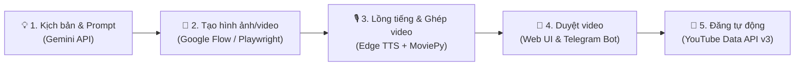

# 🎬 YouTube AI Channel Manager (Google Flow + Gemini + Telegram)

Hệ thống quản lý và sản xuất video YouTube tự động hóa toàn diện cho ngách **Tin tức công nghệ & Xu hướng AI tóm tắt**.

---

## 🌟 Quy trình hoạt động (4 Bước)



1. **AI Scriptwriter:** Sử dụng Gemini tạo kịch bản tin tức giật tít, tóm tắt nội dung, bộ tags chuẩn SEO và các câu lệnh (prompts tiếng Anh) chi tiết theo phong cách điện ảnh cho từng phân cảnh.
2. **Google Flow Automation:** Dùng Playwright tự động đưa prompt vào Google Flow (Imagen 3 & Veo) bằng profile trình duyệt đã lưu phiên đăng nhập.
3. **Audio & Video Processing:** Dùng **Edge TTS** tạo giọng đọc tiếng Việt chuẩn MC truyền hình (miễn phí, tự nhiên) và ghép các cảnh thành video hoàn chỉnh 1080p.
4. **Human-in-the-loop & Auto Upload:** Gửi video thành phẩm kèm nút **`[✅ Duyệt & Đăng]`** lên cả **Web UI trên máy tính** và **Telegram Bot trên điện thoại**. Khi bạn bấm Duyệt, video sẽ tự động được tải lên kênh YouTube của bạn.

---

## 🛠️ Cài đặt ban đầu

### 1. Cài đặt thư viện Python
Mở terminal trong thư mục này và chạy:
```powershell
pip install -r requirements.txt
playwright install chromium
```

---

### 2. Cấu hình biến môi trường (`.env`)
Mở file `.env` và điền các thông tin sau:

| Biến | Nơi lấy / Cách thiết lập |
|---|---|
| `GEMINI_API_KEY` | Lấy miễn phí tại [Google AI Studio](https://aistudio.google.com/app/apikey) |
| `TELEGRAM_BOT_TOKEN` | Chat với [@BotFather](https://t.me/BotFather) trên Telegram, gõ `/newbot` để lấy token |
| `TELEGRAM_CHAT_ID` | Chat với [@userinfobot](https://t.me/userinfobot) trên Telegram để xem ID của bạn |
| `YOUTUBE_CLIENT_SECRET_FILE` | Tải file `client_secret.json` từ Google Cloud Console (xem hướng dẫn bên dưới) |
| `YOUTUBE_PRIVACY_STATUS` | `private` (Riêng tư - khuyên dùng khi test), `unlisted` (Không công khai), hoặc `public` (Công khai) |

---

### 3. Đăng nhập Google Flow một lần duy nhất
Chạy lệnh sau để mở trình duyệt:
```powershell
python main.py --login-flow
```
* Cửa sổ trình duyệt sẽ tự động mở trang [Google Flow](https://labs.google/fx/tools/flow).
* Bạn đăng nhập tài khoản Google của bạn vào đó.
* Sau khi đăng nhập thành công, quay lại cửa sổ terminal và bấm **Enter**. Phiên đăng nhập sẽ được lưu vĩnh viễn trong thư mục `browser_profile/` cho các lần chạy tự động tiếp theo.

---

### 4. Lấy file xác thực YouTube (`client_secret.json`)
1. Truy cập [Google Cloud Console](https://console.cloud.google.com/).
2. Tạo một dự án mới (ví dụ: `YouTube-AI-Manager`).
3. Vào **APIs & Services** > **Library**, tìm **YouTube Data API v3** và bấm **Enable** (Bật).
4. Vào mục **OAuth consent screen**: Chọn loại **External**, điền tên ứng dụng và thêm email của bạn vào danh sách **Test users**.
5. Vào mục **Credentials** > **Create Credentials** > **OAuth client ID**:
   - Application type: **Desktop app**.
   - Bấm **Create**, sau đó bấm **Download JSON**.
6. Đổi tên file vừa tải về thành `client_secret.json` và đặt ngay tại thư mục gốc của dự án này.

---

## 🚀 Khởi chạy hệ thống

Chạy lệnh:
```powershell
python main.py
```

* Mở trình duyệt truy cập: **`http://127.0.0.1:8000`**
* Nhập chủ đề tin tức AI (ví dụ: *"OpenAI ra mắt GPT-5 và chip AI mới"*) và bấm **Bắt đầu tạo tự động**.
* Hệ thống sẽ tự chạy quy trình, sau đó hiển thị video lên bảng điều khiển và gửi video về Telegram kèm nút Duyệt!
